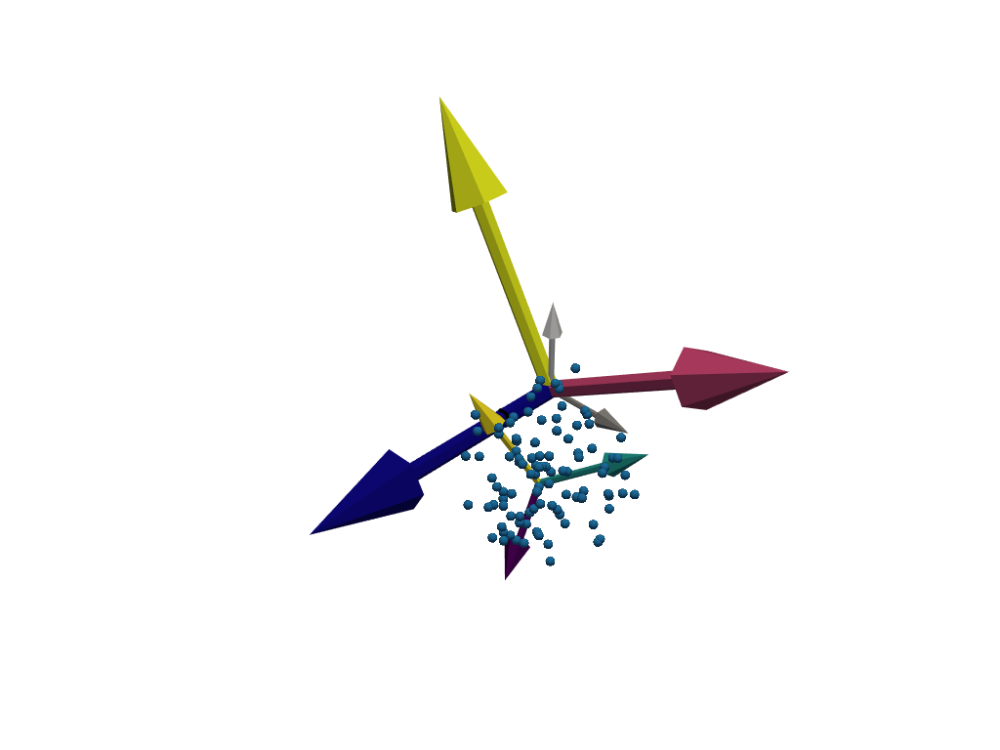

# PyFrameTree

Nested 3D coordinate frames and point-cloud transformations, with physical units.

## Installation

From the repository:

```bash
pip install -e ".[visualization]"
```

## Usage

```python
from pyframetree import CoordinateSystem
import quantities as pq
import numpy as np
import pyvista as pv
```

```python
plotter = pv.Plotter()

# Create a random point cloud
N = 100
points = np.random.rand(N, 3)

# Create a reference coordinate system
Reference = CoordinateSystem()

# Create a main coordinate system
Main = CoordinateSystem()

# Create a child coordinate system
Child = CoordinateSystem(parent=Main, name='Child')
Child.add_points(points, 'points')
Child.translate([2, 2, 0]*pq.m)
Child.rotate([0, 1, 1], 30*pq.deg)

Main.scale(3, inherit=False) # Scale the main coordinate system, but not its children
Main.rotate([1, 0, 0], 30*pq.deg, inherit=True)

Reference.visualize(plotter=plotter, children=False, cmap='gray')
Main.visualize(plotter=plotter, children=False, cmap='plasma')
Child.visualize(plotter=plotter, children=False, cmap='viridis')

plotter.save_graphic('assets/frames.svg')
```


